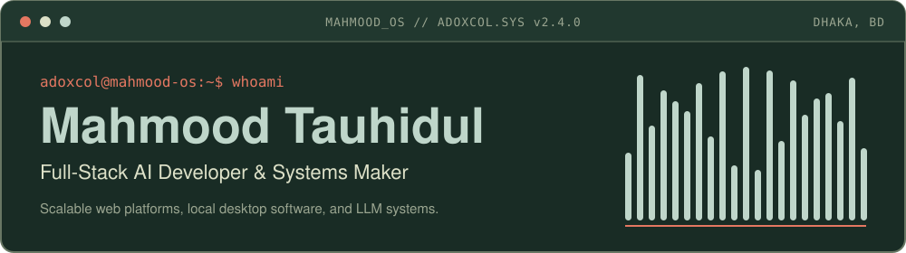
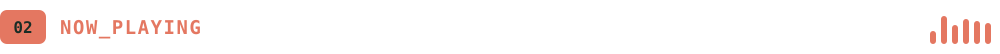
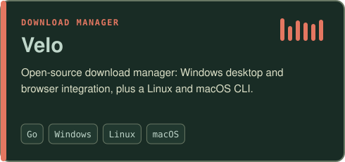
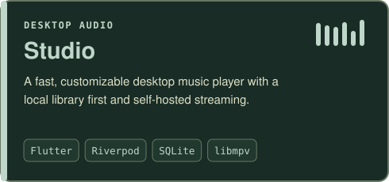
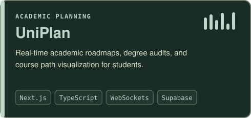
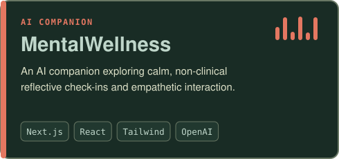
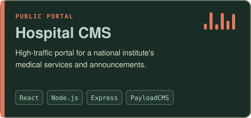
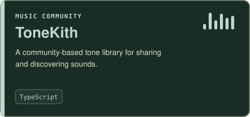

  

 

  

 

<!-- SPOTIFY_RECENTLY_PLAYED_START -->

<!-- SPOTIFY_RECENTLY_PLAYED_END -->

 

  

<b>FRONTEND &amp; UI</b> 

<b>BACKEND &amp; DATA</b> 

<b>SYSTEMS, DESKTOP &amp; AUDIO</b> 

<b>AI &amp; INTELLIGENCE</b> 

 

 

Have a project in mind, an interesting problem, or music suggestions?

Engineered with precision for <strong>Mahmood OS</strong>

